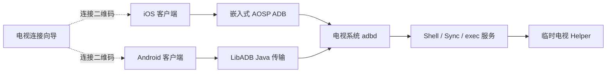

# TVADB / TVDeck 系统设计

本文描述当前源码的职责与运行边界，不作为历次修改记录。使用与构建入口见 [README.md](README.md)；开发约定和验证命令见 [AGENTS.md](AGENTS.md)。

## 1. 产品边界

| 组件 | 运行位置 | 职责 |
| --- | --- | --- |
| iOS 客户端 | iPhone / iPad，iOS 17+ | 设备连接、遥控、文件/应用管理、安装、预览与诊断 |
| Android 客户端 | 手机 / 平板，Android 8.0+ | 独立提供 ADB 遥控与管理，使用 Android 的文件授权、服务和组件能力 |
| TVDeck Connect | 电视 / 盒子，Android 6.0+ | 显示调试指引，检测传统 ADB TCP 端口并生成连接二维码 |
| 临时电视 Helper | 电视上的 ADB shell 进程 | 应用名称/图标、快速按键、编辑器同步、虚拟鼠标和特定版本视频采集 |

两端手机客户端分别实现 ADB 传输，不依赖电脑中转。TVDeck Connect 可选安装，不提供 ADB 服务、不自动打开调试，也不代替无线配对。临时 Helper 由手机客户端通过已授权 ADB 部署和启动，与电视向导 APK 独立。

ADB 权限来自电视授权及其 shell 身份。手机客户端与 Helper 不保证获得 Root 或绕过厂商权限限制。安装、设备 Shell 和 Helper 的电视端逻辑在电视运行；手机负责传输、编排和显示。

## 2. iOS 分层

| 层 | 主要文件 | 责任 |
| --- | --- | --- |
| 入口与界面 | `iosadb/IOSADBApp.swift`、`iosadb/UI/` | 全局偏好、须知门控、页面/弹框、用户交互 |
| 共享模型 | `iosadb/Models/AppModel.swift` | 主线程状态、连接生命周期、操作任务、进度及错误、当前设备和会话标识 |
| 设备命令 | `iosadb/Core/ADBCommandService.swift` | 应用、按键、鼠标、编辑器、截图/录屏、Logcat 和 Aerial 设备操作 |
| 文件服务 | `iosadb/Core/ADBSyncService.swift` 中的 `ADBFileService` | 目录与文件传输、分块/续传及远端操作 |
| 原生传输 | `iosadb/Core/ADBMobileClient.swift`、`ADBMobileShim.*` | 原生 ADB 桥接、配对/连接、命令与持久服务 |
| 发现与解析 | `DeviceDiscovery.swift`、`APKInspector.swift`、`ZipArchiveReader.swift` 等 | 局域网发现、安装包元数据、归档与兼容选择 |

主路径为 UI → AppModel → 命令/文件服务 → ADBMobileClient → 原生 ADB。`ADBClient.swift` 是另一个 Swift TCP/ADB 实现，不是当前 AppModel 主链路的替代别名。

UI 状态留在 MainActor，连接和命令遵循 actor 隔离；阻塞原生调用、解析及视频解码使用各自后台路径。应用列表按页面生命周期异步加载，离开页面后取消或使请求失效；应用名称/图标缓存也必须匹配当前设备和请求，不能用旧回调刷新新页面。

原生库从 `Vendor/adb-prebuilt/` 按目标架构准备，包含 iPhoneOS arm64、Simulator arm64/x86_64。上游源码位于 `Vendor/adb-mobile` 子模块，兼容补丁和校验见 [patches/README.md](patches/README.md)。新增 Swift 文件仍需手动维护 Xcode 项目引用与 Sources。

## 3. Android 分层

Android 客户端使用 Java 和原生 View，不采用 SwiftUI 的层级结构，也没有独立的 Android `ADBCommandService`。

| 组件 | 责任 |
| --- | --- |
| `DeckApplication` | 持有全 App 共享的 `DeckModel` |
| `MainActivity`、`ScanActivity`、`UsageNoticeActivity` | 页面、扫描入口、使用须知与操作确认 |
| `DeckModel` | 设备操作编排、连接 generation、busy/进度、Helper 会话和结果通知 |
| `AdbIdentity`、`adb-transport/` | ADB 身份、RSA/TLS/无线配对、服务流；LibADB 的本地修正 |
| `DeviceStore` | 已保存设备、当前设备及可失效 Widget token |
| `AdbFiles`、`Transfers` | ADB Sync 报文、文件选择器 URI、递归/分块/校验/续传 |
| `InstallBundle`、`ApkManifest` | 安装归档、split/OBB 与包信息分析 |
| `KeyboardSync`、`TextSession` | 输入草稿、同步调度、编辑器协议与确认排序 |
| `VideoPreview`、`AnnexB`、`VideoPackets`、`PreviewViewport` | 视频协议、MediaCodec 解码、Surface 生命周期和画面交互 |
| `ConnectionService`、`DeckWidget` | 前台连接服务、通知操作和桌面遥控 |
| `LanScanner`、`LanRouting`、`Endpoints` | 扫描、网络路由和二维码地址校验 |

`DeckModel` 为普通工作、输入和预览使用独立执行器，并通过主线程 Handler 通知界面；定时器承担超时等调度。并行通道不意味着可无界并发设备操作。状态更新、设备切换和 stream 关闭需要 generation/token 校验，Widget 与前台服务也复用同一 Model。

ADB 身份保存在私有 no-backup 存储。系统文件选择器授予本地文件/目录 URI 权限，传输不依赖整个存储访问权。对于同网段私有 IPv4，`LanRouting` 可把 ADB/配对 socket 绑定到 Wi-Fi/以太网；不会绑定整个 App，GitHub 下载保留系统默认路由，也不修改 VPN 配置。

## 4. 电视连接向导

`android-onboarding/` 是独立 Gradle 工程，核心为 `com.tvadb.onboarding.MainActivity`。界面通过主线程 Handler 刷新，端口探测由独立执行器完成；可见期间约每 2 秒检查本机 IPv4 与传统 ADB TCP 端口。

地址/端口就绪时显示 `tvadb://connect?host=<IPv4>&port=<port>`。二维码传递连接位置，不传递 ADB 身份或授权。Android 11+ 的配对端口、配对码和连接端口仍由用户从系统无线调试界面获取。向导停止可见后停止周期刷新。

包名为 `com.tvadb.onboarding`，与手机端 `com.tvdeck.client` 不同。向导最低 API 23、当前 targetSdk 28，使用 Android SDK 和随源码保留许可的 QR 编码器。

## 5. 连接与生命周期

两端均支持传统 ADB TCP/RSA，以及 Android 11+ 的 SPAKE2/TLS 配对。配对端口与连接端口不能混用。发现和二维码只提供候选地址，最终是否可用以实际连接和电视授权为准。

- 设备扫描由用户发起；iOS 使用 Bonjour 与当前 IPv4 `/24` 传统端口扫描，Android 使用 NSD 和私有 IPv4 网段扫描。进入页面或回到前台不主动扫描。
- 自动连接上次设备是独立的可选偏好，不代表扫描或预览也自动启动。
- 连接过程带可失效的请求标识。取消、手动断开和设备切换使旧连接任务及回调失效，不能恢复旧目标或覆盖新状态。
- 两端按约 15 秒节拍检查连接维护条件，ADB 空闲达到 60 秒才发送心跳；心跳打开流和读取响应共用 8 秒预算，避免忙碌连接被额外探测打断。
- iOS 后台仅申请系统有限执行时间；系统到期停止检查，不承诺挂起后长期在线。Android 使用 `connectedDevice` 前台服务和断开通知，仍可能受省电、网络和系统回收影响。
- 普通连接与断线恢复都有有限重试。Widget 冷启动使用单次 8 秒连接预算。重试只涉及建立连接，不重放设备操作。

## 6. 遥控、鼠标与键盘

### 按键和触控板

遥控主界面提供屏幕与鼠标模式，悬浮入口打开键盘和遥控中心。方向键使用 Android 标准 keycode：上/下/左/右为 19/20/21/22，OK 为 23。按键短按和长按连发互斥，连发受回执和取消控制；不能通过不断排队普通 Shell 来制造表面上的高回报率。

`RemoteKeys.java` 在电视 shell 的 `app_process` 中处理带序号的按键请求，注入 down/up 并返回回执。不可用时回退普通 `input keyevent`；回执丢失不自动重发。iOS 使用 `DirectionalKeyRepeater` 等状态机，Android 在自身输入路径管理节拍。

虚拟鼠标优先使用按电视 ABI 部署的 UHID 助手，并尝试主显示器关联；受限时回退 AOSP/direct uinput 及兼容输入。`MouseMotionAccumulator` 合并 iOS 相对位移，避免命令拥堵或丢失累计轨迹。双指方向键与单指鼠标分流，横向支持持续方向输入，提示位于触控板下方。后台或切页需停止旧手势，前台恢复时重新确认鼠标控制会话。

### UTF-8 编辑器同步

| 平台 | 调用链 |
| --- | --- |
| iOS | `RemoteKeyboardPanel` → `RemoteKeyboardSync` → `RemoteTextSession` → `TextSync.java` |
| Android | `MainActivity` 键盘弹框 → `KeyboardSync` / `TextSession` → `TextSync.java` |

TextSync 临时进程通过 UiAutomation 操作当前应用的可编辑输入框，不安装输入法或常驻 APK。仅打开键盘弹框时建立会话，关闭时关闭流并退出自动化连接。

GET 读取焦点 token 和全文；SET/CONFIRM 同时校验 token 与预期原文，成功必须收到匹配序号的回执。UTF-8 内容通过协议编码传输，中文组词中间态不发送。输入法候选窗口、hint 和密码框不得作为正文读取；焦点或原文冲突保留手机草稿并暂停，等待显式重新同步。不支持编辑时不会盲目退格或追加覆盖。旧 ASCII `input text` 路径与此协议分离。

## 7. 实时屏幕与录制

预览是独立的、由用户手动启动的持久 ADB 会话，离开页面、进入后台或停止后关闭；回来不自动重开。Android 10–11 的适用场景优先临时 `VideoStream.java` 硬件采集助手，失败后尝试原生 `screenrecord`，视频链路失败再进入 PNG 截图兼容模式。

| 环节 | iOS | Android |
| --- | --- | --- |
| 视频接收 | 持久 exec、分片解析及专用队列 | 独立预览执行器、Annex-B/带边界视频包 |
| 解码 | `H264StreamDecoder` / VideoToolbox | `VideoPreview` / MediaCodec |
| 显示 | `LatestFrameBuffer`、`H264VideoSurface` | Surface 与 `PreviewViewport` |

默认目标为最长边 1280、约 2 Mbps、尺寸按 16 对齐，不修改电视系统分辨率。只允许覆盖已解码的完整过期画面，不能任意丢压缩参考帧；解码、交付和界面刷新均避免无界排队。iOS 不将每帧图像写入全局 SwiftUI 状态，Android 保持 Surface 生命周期和画面尺寸稳定。

15/30/60 秒 MP4 录制与实时预览是不同操作；完成后拉回手机导出，默认无系统或麦克风音频。编码器、DRM、厂商缓冲及无线网络会影响实际效果。细节与实测记录见 [docs/live-preview.md](docs/live-preview.md)。

## 8. 文件、应用和 Shell

文件服务复用 ADB Sync，递归/续传按平台实现。Android 上传先制作源文件快照，按远端路径、设备和内容标识维护分块进度；下载校验后再写系统文档。外部文件名、归档路径、数据长度和递归深度是信任边界，不能取消校验来兼容异常输入。

应用名称与图标通过临时 `AppPresentationHelper` 获取，无法使用时保留包名和默认图标。缓存须按设备/应用失效；卸载后刷新列表，旧请求不能恢复已删除行。安装支持 APK 与 split 归档、OBB 和失败清理，但两端分析能力不同：iOS 有更完整的二进制 Manifest/签名方案分析，Android 依赖其包解析器，并不解析所有 bundletool 定向元数据。

Shell 由用户点击执行，命令在目标电视执行。预设、关键词和收藏仅用于填充；程序生成的参数必须引用和校验。命令提交、Shell 退出、安装成功、授权成功等是不同状态，不能仅凭流写入成功就提示整个操作完成。

## 9. Aerial 联动

`AerialIntegration.swift` 与 Android `AerialIntegration.java` 提供二维码、版本类型、下载与安装策略；具体设备操作分别由命令服务/Model 编排。

扫描 Aerial 管理二维码不要求先连接 ADB：iOS 在内置 Safari 页面打开，Android 交给浏览器。管理二维码与电视连接二维码分开校验；含动态令牌的完整地址不持久化、不写日志。详情页仅显示 `http://<电视 IP>:8790` 基础地址，不能据此拼出完整管理链接。

连接 ADB 后检测已安装状态；下载官方稳定版时校验大小、SHA-256、包名与版本。升级保留 Standard/Guard/Lite 类型和数据，不主动降级或卸载。安装/升级、Guard 重试和单独授权前均需明确确认，确认绑定当前设备会话与版本类型，失效后重新确认。

两端使用相同详情结构与操作顺序。下载按字节显示进度，安装等待使用不定进度，授权按步骤推进。单步结果与最终启动分别判定，不宣称已完成默认桌面接管；不主动设置默认桌面、屏保、保持 ADB 常开或重启。用户说明见 [docs/aerial.md](docs/aerial.md)。

## 10. 使用须知与 Widget

使用须知是功能门控，不仅是启动页面。首次启动时 iOS 在未开放主界面的背景上显示居中卡片，Android 在主窗口首帧显示后打开独立浮动 Activity，保留未开放功能的主窗口作为背景，同意后重新初始化主页面；两端高度受限、正文滚动，确认区保留在底部，不采用全屏展示。iOS 设置入口使用受限高度的 sheet。两端在版本或声明区域不匹配时要求主动确认；CN 使用大陆版，其余使用国际版，无法获取时回退大陆版。地区只读系统设置，声明语言独立选择。未确认时连接、扫描、设备命令、后台维护和 Widget 入口都必须拒绝。设置保留声明及本机确认记录入口，不向 Widget 导出该记录。

iOS Widget 的链路为 `TVADBWidget` → `TVRemoteWidgetIntent` → `TVADBWidgetController` → `TVADBAppRuntime.model`。App Group 仅保存展示与连接标识，不存 ADB 身份。Android 由 `DeckWidget` 将白名单按键交给 `ConnectionService` 和共享 Model，校验设备 ID/token。两端切换设备或手动断开使旧按钮失效，冷启动只恢复指定目标。Widget 显示不是实时在线监控，也不提供 App 内相同的长按连发。详见 [docs/home-screen-widget.md](docs/home-screen-widget.md)。

## 11. 构建资源、发布与验证

- iOS 与 Android 各自持有随包 Helper：iOS 为 `iosadb/Resources/`，Android 为 `app/src/main/assets/`。协议或源码变动须核对两端资源；现有部分 Helper 脚本仅更新 iOS，视频脚本同时更新两端，不能假定所有脚本行为相同。
- iOS 模拟器运行、无签名 IPA、Android 调试构建和两端 Android Release 均有 `scripts/` 入口。Release 包默认未签名；提供环境变量时执行 zipalign、签名及验证。升级依赖同一包名与签名，密钥不进入源码。
- Android 手机客户端与电视向导分别使用独立的手动 Actions，输入版本名和递增 versionCode 后注入 APK。流程复用各自 Release 脚本，以 Secrets 签名并上传 APK 和校验清单，创建 `android-v…` / `tv-v…` Release 草稿；由用户检查后发布，不覆盖已有版本。流程与本地构建应使用相同密钥。
- 主机逻辑测试覆盖协议、状态机、解析和边界；Android 单元测试不等于设备测试。无签名构建不能证明设备签名、App Group 或电视权限可用。
- 真机仍需验证 OEM 配对/输入法、UHID/uinput 权限、编码器、后台回收、文件提供方和网络隔离。不把旧记录、跳过的测试或单次构建写成当前真机通过结论。
