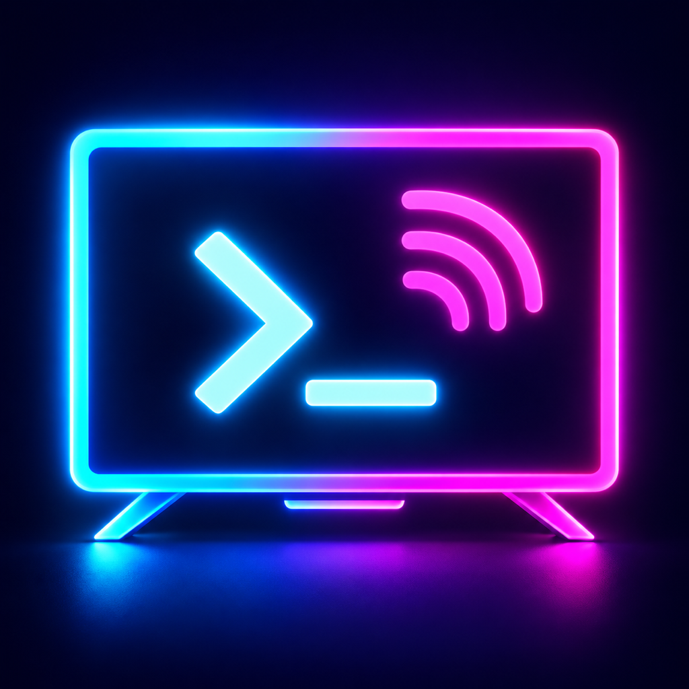

# TVADB / TVDeck

  <strong>简体中文</strong> · <a href="README_EN.md">English</a>

  

  面向 Android TV 的 iPhone / iPad、Android 手机 / 平板 ADB 客户端，以及可选电视连接向导。

  
  
  
  
  

## 选择你的客户端

| 安装位置 | 文档 | 用途 |
| --- | --- | --- |
| iPhone / iPad，iOS 17+ | [iOS 客户端](docs/ios.md) | ADB 遥控、文件与应用管理、实时画面及系统工具 |
| Android 手机 / 平板，Android 8.0+ | [Android 客户端](android-client/README.md) | 独立 ADB 遥控和管理，无需 iPhone 或电脑中转 |
| Android TV / 盒子，Android 6.0+ | [电视连接向导](android-onboarding/README.md) | 显示开启调试指引及传统 ADB 连接二维码，可选安装 |

电视连接向导不会自动开启 ADB 或代替无线配对；两端手机客户端都可直接手动连接电视。

## 功能概览

两端手机客户端均已实现设备发现与保存、ADB TCP/RSA、Android 11+ 无线配对、文件传输与续传、APK/split 安装、应用管理、方向键与虚拟鼠标、UTF-8 同步键盘、手动实时预览、截图与无声录屏、Shell、Logcat、遥控 Widget，以及 Aerial 扫码和安装联动。

两端功能细节和系统集成有差异，请查看各端文档。已实现不代表所有品牌电视均已真机验收；输入权限、视频编码、后台连接等能力受电视固件和手机系统限制。

## 公共使用指南

- [连接 Android TV](docs/device-connection.md)：传统 ADB TCP 与 Android 11+ 无线配对。
- [Aerial 联动](docs/aerial.md)：扫码管理、安装/升级、授权与启动。
- [安全说明](docs/security.md)：设备授权、敏感信息和高权限操作。
- [工程结构](docs/project-structure.md)：三端源码、辅助工具和构建脚本位置。

## 项目出处

当前项目：[woyounai/tvDeck](https://github.com/woyounai/tvDeck)。原始项目与开发历史出处：[wy164519317/tvadb](https://github.com/wy164519317/tvadb)。TVADB / TVDeck 是本仓库的项目及客户端名称，借助 AI 开发，与 Google、电视厂商及 Aerial 官方无隶属关系。

iOS 底层基于 [wsvn53/adb-mobile](https://github.com/wsvn53/adb-mobile) 和 AOSP ADB；Android 传输基于 [LibADB Android 3.1.1](https://github.com/MuntashirAkon/libadb-android/tree/3.1.1)，保留原作者版权与许可。Aerial 是独立的[第三方项目](https://github.com/pengchujin/aerial-tv)，本项目提供连接及经用户同意的安装联动，不将其作为自有代码。完整归属见 [第三方声明](THIRD_PARTY_NOTICES.md)。

## 开源协议

TVADB 自有源码采用宽松的 [MIT License](LICENSE) 开源。你可以自由使用、复制、修改、合并、发布、分发、再许可和销售，但须保留原版权及许可声明。软件按原样提供，不附带保证。

`Vendor/` 中的 AOSP ADB 及第三方依赖不受本项目 MIT 许可重新授权，仍分别遵循其原有 LICENSE 和 NOTICE。详情见 [THIRD_PARTY_NOTICES.md](THIRD_PARTY_NOTICES.md)。

## 第三方代码

项目包含 AOSP ADB 及其依赖的预编译静态库。完整上游源码通过 `Vendor/adb-mobile` submodule 提供，TVADB 使用的兼容补丁与二进制校验值位于 [`patches/`](patches/README.md)。在重新分发或商业发布前，请保留适用的版权与许可证声明。
