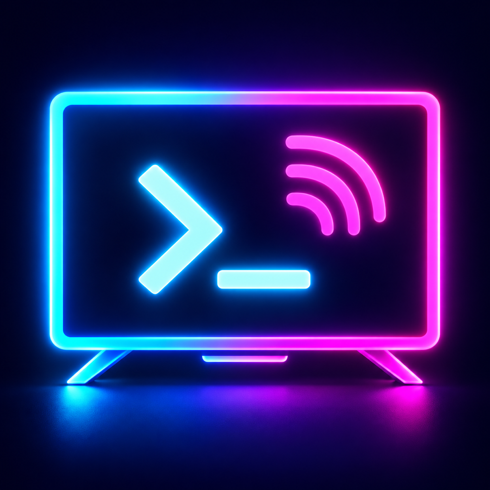

# TVADB / TVDeck

  <a href="README.md">简体中文</a> · <strong>English</strong>

  

  ADB clients for iPhone / iPad and Android phones / tablets, with an optional Android TV connection companion.

  
  
  
  
  

## Choose your client

| Install on | Documentation | Purpose |
| --- | --- | --- |
| iPhone / iPad, iOS 17+ | [iOS client](docs/ios.en.md) | ADB remote control, file/app management, live screen and system tools |
| Android phone / tablet, Android 8.0+ | [Android client](android-client/README_EN.md) | Independent ADB control and management, without an iPhone or relay computer |
| Android TV / box, Android 6.0+ | [TV companion](android-onboarding/README_EN.md) | Optional debugging guidance and classic ADB connection QR code |

The TV companion cannot enable ADB or replace wireless pairing. Either mobile client supports manual connection without it.

## Feature overview

Both mobile clients implement discovery and saved devices, ADB TCP/RSA, Android 11+ pairing, file transfers and resume, APK/split installation, app management, directional controls and virtual mouse, UTF-8 keyboard synchronization, manual live preview, screenshots and silent recordings, Shell, Logcat, remote widgets, and Aerial QR/installation integration.

Feature details and platform integration differ; consult each client's documentation. Implementation does not imply validation on every TV brand. Input permissions, video encoding and background connectivity depend on TV firmware and the mobile OS.

## Shared guides

- [Connect to Android TV](docs/device-connection.en.md): classic ADB TCP and Android 11+ pairing.
- [Aerial integration](docs/aerial.en.md): management QR, installation, upgrades and authorization.
- [Security](docs/security.en.md): device authorization, sensitive information and privileged operations.
- [Project structure](docs/project-structure.en.md): source directories, helpers and build scripts.

## Project origin

Current project: [woyounai/tvDeck](https://github.com/woyounai/tvDeck). Original project and development history: [wy164519317/tvadb](https://github.com/wy164519317/tvadb). TVADB / TVDeck are this project's names. Development is AI-assisted. The project is not affiliated with Google, TV manufacturers, or Aerial.

The iOS transport derives from [wsvn53/adb-mobile](https://github.com/wsvn53/adb-mobile) and AOSP ADB. Android uses locally patched [LibADB Android 3.1.1](https://github.com/MuntashirAkon/libadb-android/tree/3.1.1), retaining upstream notices. [Aerial](https://github.com/pengchujin/aerial-tv) is an independent third-party project; this app provides integration and user-approved installation. See [third-party notices](THIRD_PARTY_NOTICES.md).

## License

TVADB's original source code is released under the permissive [MIT License](LICENSE). You may use, copy, modify, merge, publish, distribute, sublicense, and sell it, provided that the original copyright and license notice are retained. The software is provided as-is, without warranty.

AOSP ADB and third-party dependencies under `Vendor/` are not relicensed under this project's MIT License. They remain subject to their respective LICENSE and NOTICE files. See [THIRD_PARTY_NOTICES.md](THIRD_PARTY_NOTICES.md).

## Third-Party Code

This project includes prebuilt static libraries for AOSP ADB and its dependencies. Complete upstream source is available through the `Vendor/adb-mobile` submodule; the compatibility patches and binary checksums used by TVADB are stored in [`patches/`](patches/README.md). Retain all applicable copyright and license notices when redistributing or publishing commercially.
