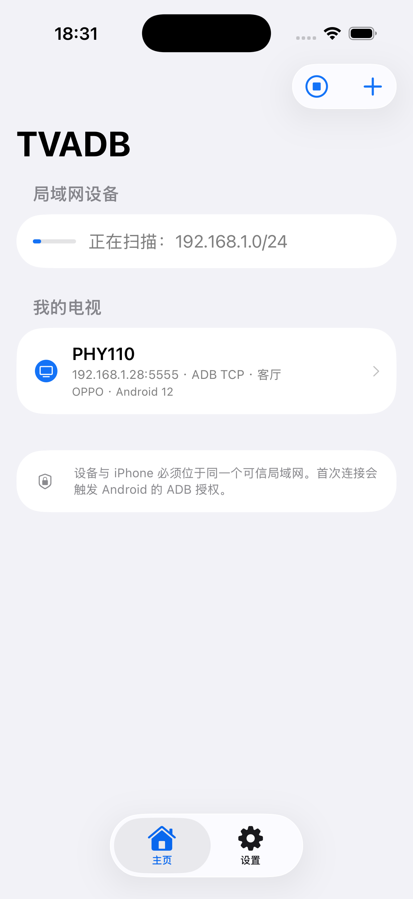
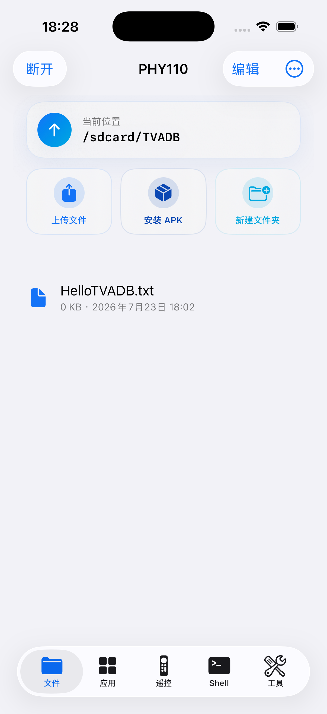
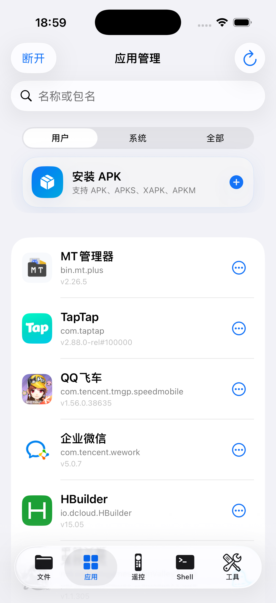
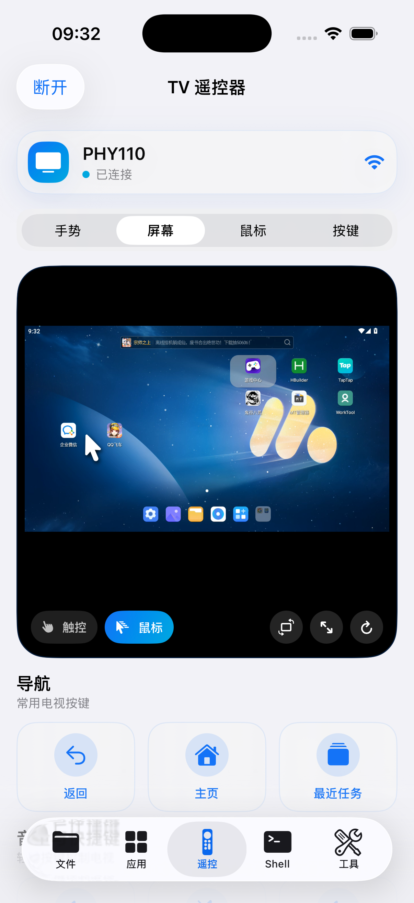
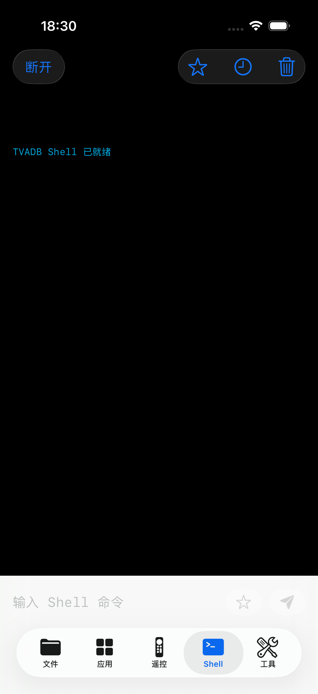
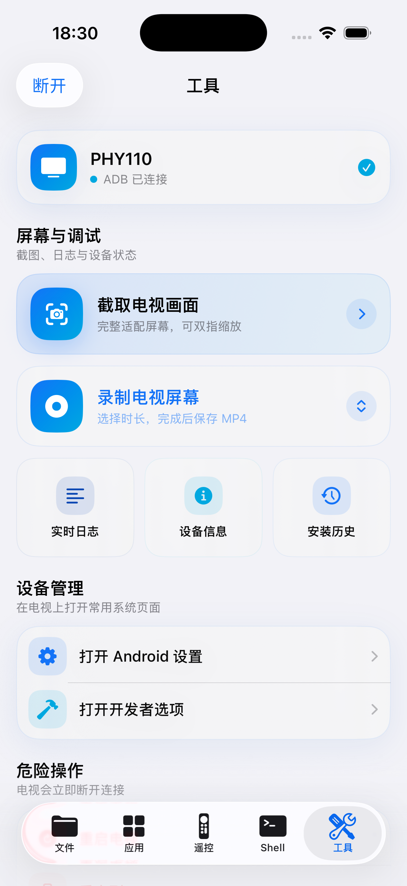
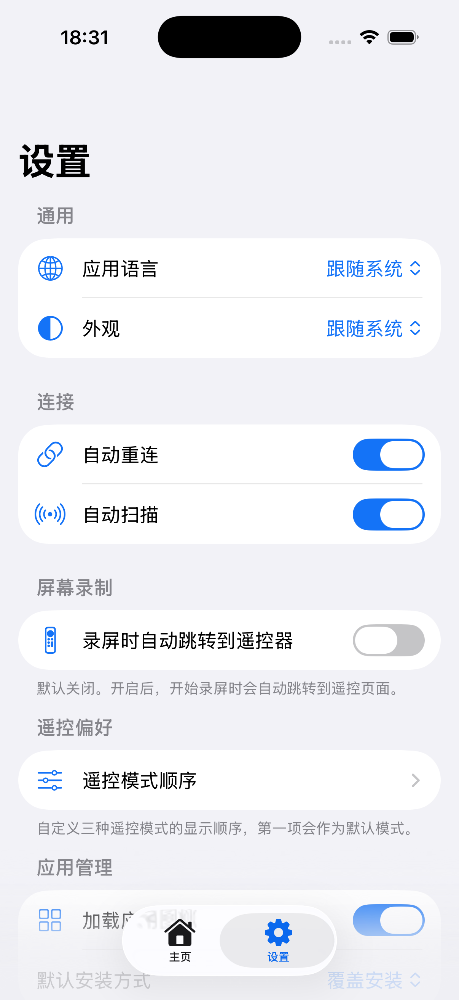

# iOS client

[简体中文](ios.md) · [English](ios.en.md)

[Project overview](../README_EN.md) · [Connect a TV](device-connection.en.md) · [Aerial integration](aerial.en.md)

Run all commands below from the repository root.

TVADB is a native SwiftUI ADB client for iPhone / iPad, requiring iOS 17+. Bundle ID: `com.tvadb.ios`. The screenshots, integrations and build steps below describe the iOS app.

## Background

Good ADB tools for iOS are scarce, and truly open-source options that can be maintained over the long term are even rarer. I therefore used AI to build the tool I needed, one piece at a time. If you can sign iOS apps, you can build, sign, and install TVADB yourself. You do not have to wait for a closed-source app to be updated or worry that it may stop being maintained one day. The code is public, so anyone can improve it and keep it alive—**sign it yourself if you can; open source lives forever.**

TVADB turns an iPhone into a remote and management tool for Android TV. Its embedded ADB core connects directly over a trusted local network without a relay computer. From the phone, you can control playback, view the live screen, install APKs, manage files and apps, run Shell commands, inspect logs, and save screenshots or recordings. The optional TVADB Connect app detects an enabled classic ADB TCP port and displays a QR code for iPhone setup; Android 11+ wireless debugging still requires pairing first.

Choose the Neon or Pearl icon under Settings → General → App Icon. The launch screen displays the TVADB mark.

> This repository contains a runnable core version that is ready for continued development. Differences that still need validation across TV brands are tracked separately as community compatibility testing rather than unfinished core work.

## iOS screenshots

<table>
  <tr>
    <td align="center"><br><sub>Device discovery</sub></td>
    <td align="center"><br><sub>File manager</sub></td>
    <td align="center"><br><sub>App management</sub></td>
    <td align="center"><br><sub>Live screen remote</sub></td>
  </tr>
  <tr>
    <td align="center"><br><sub>ADB Shell</sub></td>
    <td align="center"><br><sub>System tools</sub></td>
    <td align="center"><br><sub>App settings</sub></td>
    <td align="center"><sub>All images are native device screenshots exported with Simulator Save Screen</sub></td>
  </tr>
</table>

## Implemented iOS features

| Module | Current capabilities |
| --- | --- |
| Device discovery | Listens for `_adb._tcp`, `_adb-tls-pairing._tcp`, and `_adb-tls-connect._tcp` over Bonjour, and scans ADB TCP port 5555 on the current Wi-Fi IPv4 `/24` subnet |
| Device management | Manual setup, multiple saved devices, favorites, groups, notes, editing, recent connections, automatic reconnection, and device information |
| ADB connection | Legacy ADB TCP/RSA plus Android 11+ SPAKE2, TLS 1.3, certificate persistence, and wireless pairing-code flow |
| APK installation and inspection | APK, APKS, XAPK, and APKM; device-aware split selection and XAPK OBB deployment; icon, binary Manifest, version, SDK, ABI, V1/V2/V3/V3.1 signature, permission, and component inspection |
| File management | Local iPhone/iPad and TV browsing, recursive multi-file/folder transfer, resumable chunks, batch download/delete, rename, and folder creation; two-pane iPad layout and drag and drop |
| App management | User/system app lists with real names and icons loaded in batches from the TV's `PackageManager` by a temporary DEX helper and persistently cached; devices that reject the helper retain package names and default icons; plus search, launch, force stop, clear cache, clear data, uninstall, and complete base/split APK export |
| ADB Shell | Arbitrary commands, common commands, local command history, and favorite commands |
| TV remote | Directional controls, OK, Home, Back, Menu, Recent, volume, mute, power, a gesture D-pad, and a low-latency system mouse trackpad that prefers physical-style UHID and automatically falls back to `uinput`; drag, double-click, right/middle click, and wheel actions are supported |
| Live screen | Continuously transports H.264 over a dedicated ADB channel, decodes it in hardware with VideoToolbox, and drops stale frames to minimize latency; includes touch/mouse modes, zoom, rotation, and fullscreen shortcuts, with automatic screenshot fallback on devices that reject the video stream |
| Screenshots | Prefers `exec-out screencap` with ADB Sync `pull` fallback; fit-to-screen display, pinch to zoom, drag, double-tap zoom, and save to Photos |
| System tools | Fixed-duration MP4 screen recording; near-real-time incremental Logcat with search, Tag/PID/level filters, pause, and TXT export; device details including IP, MAC, and battery; settings, developer options, and reboot tools |
| iOS integration | Shares or imports packages from the Files app, registers APK/APKS/XAPK/APKM file types, and provides appearance, installation mode, log level, and default transfer-directory settings; Simplified Chinese and English can follow the system or switch in-app |

Also implemented: synchronized keyboard, two-finger directions, remote widgets, idle heartbeat, bounded reconnect, Aerial integration and versioned usage consent. Keyboard sync rejects password fields and protects against focus and text conflicts.

## iOS project status

### Implemented

- ✅ Native AOSP ADB 35 core builds for iPhoneOS arm64 and iOS Simulator arm64/x86_64.
- ✅ ADB TCP/RSA connection and authorization, Shell, Sync file transfer, and APK installation.
- ✅ Native SPAKE2/TLS flow required for Android 11+ wireless pairing.
- ✅ Current-subnet discovery and manual IP/port connections.
- ✅ File, app, Shell, remote, screenshot, and basic system-tool interfaces.
- ✅ Near-real-time incremental Logcat with search, Tag/PID/level filters, pause, clear, and TXT export.
- ✅ Device-aware split selection for APKS/APKM/XAPK, multi-APK installation, and automatic XAPK OBB deployment.
- ✅ Recursive multi-file/folder transfer, 64-bit file sizes, chunked upload/download, and transfer resumption.
- ✅ APK icon, binary Manifest, signature, permission, Activity, Service, Receiver, Provider, and SharedUserId inspection.
- ✅ Batched, install-free helper loading and persistent caching for installed-app names/icons; default icons on devices that reject the helper; plus complete base/split APK export.
- ✅ Two-pane local/TV file management on iPad, two-way transfer, and drag-to-upload/install.
- ✅ Native system mouse trackpad (Linux UHID first to emulate a physical HID mouse, with automatic AOSP `uinput` and four-ABI helper fallbacks), using a persistent ADB control stream and pointer coalescing for lower latency, with drag, double-click, right/middle click, and wheel actions. Includes 15/30/60-second TV MP4 recording and export.
- ✅ Dedicated ADB H.264 live-screen channel with iOS VideoToolbox hardware decoding, zero playback buffering, stale-frame dropping, first-frame timeout fallback, and a screenshot compatibility mode.
- ✅ Device editing, groups and notes, Shell command favorites, version-aware installation history, and an opt-in, off-by-default connection to the last device on launch/foreground.
- ✅ Light, dark, and tinted app icons plus appearance, installation mode, default upload/download directory, and log-level settings.
- ✅ Unsigned IPA build script and one-command simulator runner.

### Community Compatibility Testing

The Android 11+ pairing path, common APKS/APKM/XAPK installation paths, ADB mouse, and screen recording are implemented. TV brands, firmware versions, pointer policies, video encoders, and third-party package generators still differ, so remaining problems are tracked as compatibility feedback rather than unfinished core features. Issues and pull requests are welcome; include the TV brand, model, Android version, package source, and sanitized logs. Never publish pairing codes, ADB private keys, or certificate private keys.

## iOS requirements

- macOS with a full Xcode installation.
- iOS 17 or later; the app has been built and run on the iOS 26 simulator.
- An Apple Silicon or Intel Mac; both arm64 and x86_64 simulator ADB static libraries are included.
- Installing on a physical device requires a signing certificate, private key, and provisioning profile that match your Bundle ID.
- Android TV must have Developer options and either Wireless debugging or ADB TCP enabled.

Current configuration:

| Item | Value |
| --- | --- |
| Bundle ID | `com.tvadb.ios` |
| Minimum OS | iOS 17.0 |
| Swift | 5.0 |

## iOS build and run

### Xcode Simulator

Normal builds use the supplied prebuilt libraries and need no submodule initialization. Only when rebuilding the ADB core, read `patches/README.md` and initialize upstream sources:

```bash
git submodule update --init --recursive
```

Open `iosadb.xcodeproj` and choose a specific simulator from the device menu at the top of Xcode, such as `iPhone 17 Pro`. Do not select `Any iOS Device (arm64)`. Then press `⌘R`. Xcode automatically prepares the arm64 or x86_64 ADB static library for the selected architecture.

You can also build, install, and launch the app with:

```bash
./scripts/run-simulator.sh
```

To use a different simulator:

```bash
./scripts/run-simulator.sh "iPad mini (A17 Pro)"
```

The simulator does not require a development certificate or developer account, so it is useful for reviewing the UI and local logic. TV authorization, APK installation, wireless pairing, and file transfer should still be verified on a physical iPhone.

### Build an Unsigned IPA

```bash
./scripts/build-unsigned-ipa.sh
```

Output:

```text
dist/TVADB-unsigned.ipa
```

The IPA is unsigned by default. You can re-sign it with an enterprise certificate, but the certificate, private key, provisioning profile, and Bundle ID must match. Enterprise distribution does not require a separate Apple Development certificate, and simulator debugging does not require code signing.

## iOS FAQ

### The TV is not found automatically

- Make sure the iPhone has granted TVADB access to the local network.
- Make sure Wireless debugging or ADB TCP port 5555 is enabled on the TV.
- Check that the iPhone and TV are on the same routable network.
- Guest Wi-Fi, AP isolation, and corporate network policies may block device-to-device traffic.
- The Android 11+ Wireless debugging connection port is usually not 5555. Use pairing discovery or enter it manually.

### File upload or APK installation appears to do nothing

Make sure the app is still connected to the TV and select a real file in the system file picker. Files stored in iCloud must finish downloading first, and installation bundles must contain valid APK files.

### Which operations may be restricted by TV permissions?

Access to `Android/obb`, uninstalling system apps, Recovery, Bootloader, and some `settings` commands depends on the TV firmware and ADB user permissions.

### How does Mouse mode display the TV's system pointer?

TVADB temporarily uploads a lightweight helper matching the TV's CPU architecture and first tries to register a standard USB mouse report descriptor through `/dev/uhid`. This is the closest wireless-ADB equivalent to a physical HID mouse. Android 15 supports independent cursors per display, so TVADB explicitly associates the UHID physical input port with the primary display. This prevents a recognized physical mouse from being routed to `DisplayId -1`, where only a clipped shadow may appear at the top-left corner. If UHID or display association is unavailable, TVADB falls back to the firmware's AOSP `uinput` command and then the helper's direct `/dev/uinput` mode; compatibility clicks remain available if all kernel paths are restricted. Classic ADB TCP connections reuse a persistent control stream for mouse reports; transports that do not accept the stream automatically fall back to ordinary Shell commands without losing functionality. The helper installs no APK, requires no root access, and is stopped and cleaned up when the ADB session ends.

Some desktop Android emulators render their visible mouse arrow in the Windows or macOS host process instead of Android's SurfaceFlinger. ADB alone cannot ask the emulator host to display that arrow, and a virtual mouse may leave only an invisible-pointer hover shadow. TVADB automatically switches recognized emulators to coordinate-touch mode: the phone trackpad maps the whole Android display, so users can tap the matching position directly or drag the phone-side coordinate marker and tap. Clicks use Android touchscreen input, removing the stale hover shadow while keeping single-click reliable. Real TVs still prefer UHID/uinput; whether they render a native pointer depends on the TV kernel, ADB shell permissions, and vendor pointer policy.

### Does screen recording include audio?

Android `screenrecord` captures video without system or microphone audio by default. TVADB offers 15-, 30-, and 60-second recordings and pulls the completed MP4 back to the iPhone.
