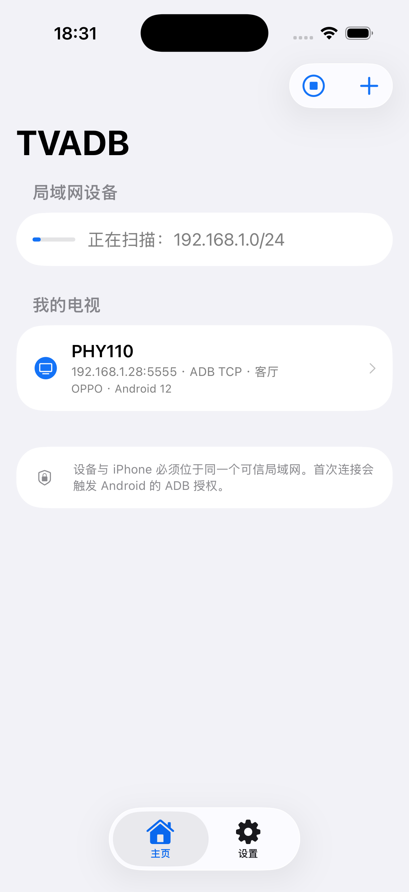
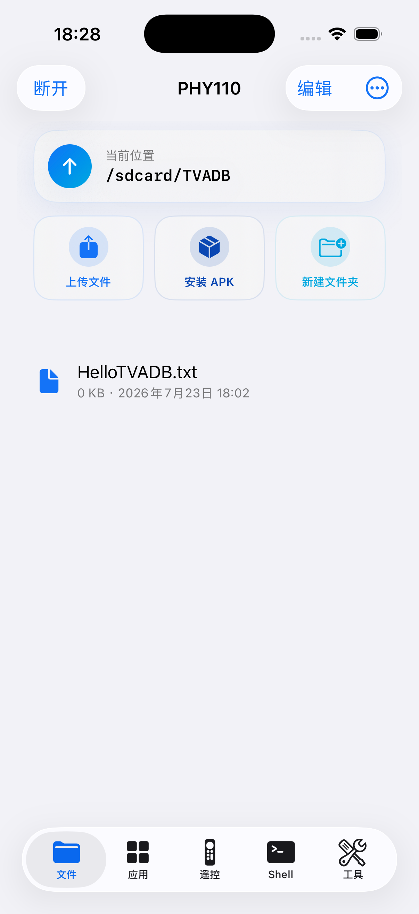
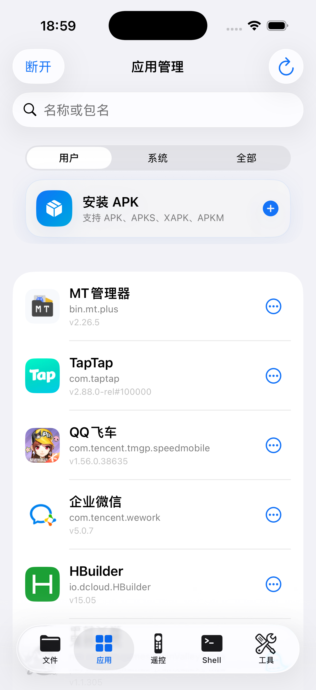
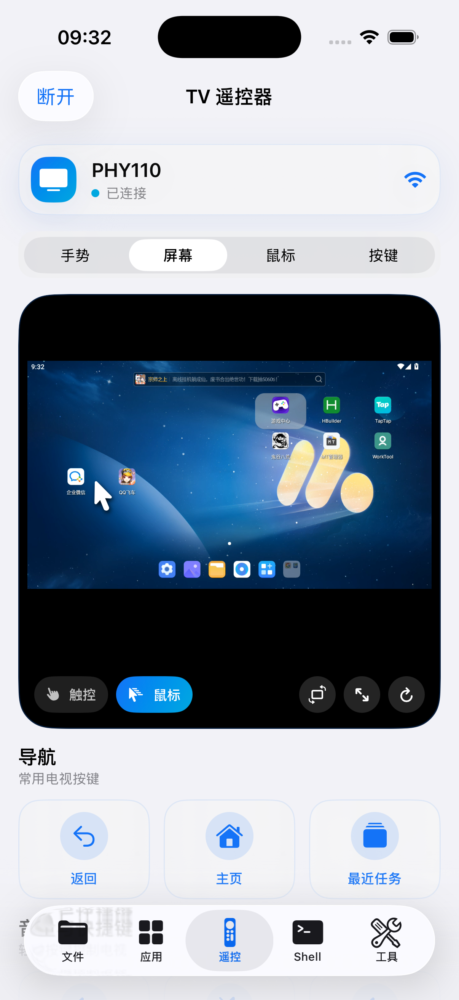
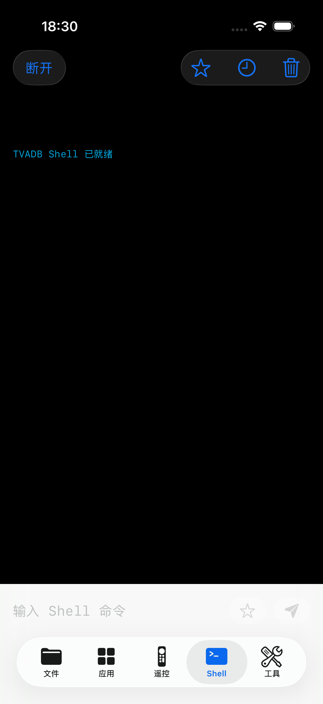
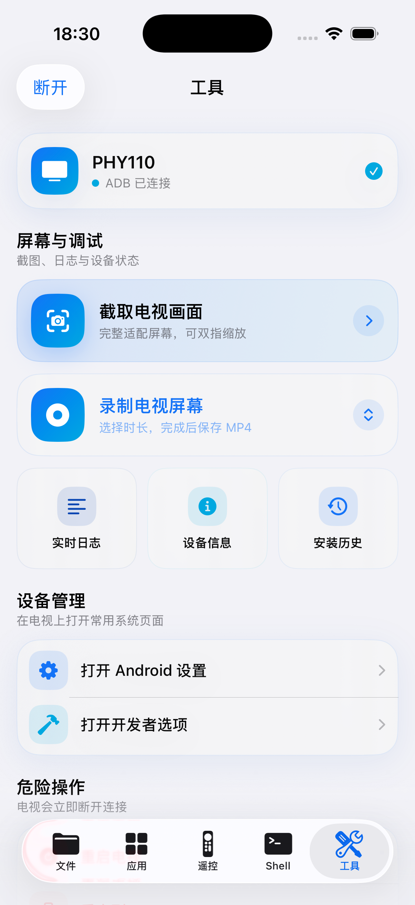
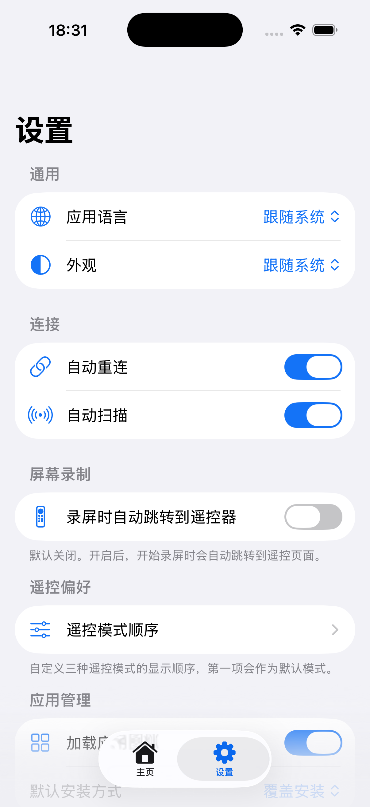

# iOS 客户端

[简体中文](ios.md) · [English](ios.en.md)

[返回项目总览](../README.md) · [连接电视](device-connection.md) · [Aerial 联动](aerial.md)

以下命令均在仓库根目录执行。

TVADB 是 iPhone / iPad 上的原生 SwiftUI ADB 客户端，最低 iOS 17，Bundle ID 为 `com.tvadb.ios`。以下截图、系统集成和构建步骤均属于 iOS 版。

## 开发背景

iOS 上好用的 ADB 工具选择并不多，真正开源、能够持续维护的方案更少。于是我借助 AI，把自己需要的工具一点点写了出来。只要你有签名能力，就可以自己构建、自己签名、自己安装，不必等待某个闭源 App 更新，也不必担心它有一天停止维护。代码公开，任何人都能继续改进和接力维护——**有能力就自己签名，开源才能永生。**

TVADB 是面向 Android TV 的 iPhone 遥控与管理工具。它将 ADB 核心嵌入 App，在可信局域网内直连电视，无需电脑中转。连接后可遥控、查看实时画面、安装 APK、管理文件与应用、执行 Shell、查看日志及保存截图和录屏。电视端 TVADB Connect 可检测已开启的传统 ADB TCP 端口，展示供 iPhone 扫描的连接二维码；Android 11+ 无线调试仍需先配对。

“设置 → 通用 → App 图标”可在霓虹和珠白图标之间切换。启动页显示 TVADB 标识。

> 当前仓库是可运行、可继续开发的核心版本。尚待不同品牌真机验证的差异单独列为社区兼容测试，不把兼容性反馈描述为未完成的核心功能。

## iOS 界面预览

<table>
  <tr>
    <td align="center"><br><sub>设备发现</sub></td>
    <td align="center"><br><sub>文件管理</sub></td>
    <td align="center"><br><sub>应用管理</sub></td>
    <td align="center"><br><sub>实时屏幕遥控</sub></td>
  </tr>
  <tr>
    <td align="center"><br><sub>ADB Shell</sub></td>
    <td align="center"><br><sub>系统工具</sub></td>
    <td align="center"><br><sub>应用设置</sub></td>
    <td align="center"><sub>所有图片均为 Simulator“存储屏幕”导出的原生设备截图</sub></td>
  </tr>
</table>

## iOS 已实现功能

| 模块 | 当前能力 |
| --- | --- |
| 设备发现 | Bonjour 监听 `_adb._tcp`、`_adb-tls-pairing._tcp`、`_adb-tls-connect._tcp`，并扫描当前 Wi-Fi IPv4 `/24` 网段的 ADB TCP 5555 |
| 设备管理 | 手动添加、保存多个设备、收藏、分组、备注、编辑、最近连接、自动重连和设备信息回填 |
| ADB 连接 | 传统 ADB TCP/RSA；Android 11+ SPAKE2、TLS 1.3、证书持久化与无线配对码流程 |
| APK 安装与分析 | APK、APKS、XAPK、APKM；按设备 ABI/屏幕密度选择 split、XAPK OBB 部署；解析图标、二进制 Manifest、版本、SDK、ABI、V1/V2/V3/V3.1 签名、权限和组件 |
| 文件管理 | iPhone/iPad 本地与电视文件浏览、多文件及目录递归上传/下载、分块续传、批量下载/删除、重命名、新建文件夹；iPad 双栏与拖拽 |
| 应用管理 | 用户/系统应用列表、通过临时 DEX Helper 调用电视 `PackageManager` 批量读取真实名称与图标并持久缓存；Helper 不可用时保留包名和默认图标；支持搜索、启动、停止、清缓存、清数据、卸载，以及 base/split APK 导出 |
| ADB Shell | 任意命令、常用命令、本地命令历史和收藏命令 |
| TV 遥控器 | 方向、OK、Home、Back、Menu、Recent、音量、静音、电源、手势方向板，以及优先模拟物理 UHID、自动回退 `uinput` 的低延迟系统鼠标触控板；支持拖动、双击、右/中键和滚轮 |
| 实时屏幕 | 通过独立 ADB 通道持续传输 H.264，使用 VideoToolbox 硬件解码并主动丢弃过期帧以降低延迟；支持触控/鼠标模式、缩放、旋转和全屏快捷控制，不支持视频流的设备自动回退截图兼容模式 |
| 屏幕截图 | `exec-out screencap` 优先、ADB Sync `pull` 回退；适配屏幕、双指缩放、拖动、双击放大和保存照片 |
| 系统工具 | 固定时长 MP4 录屏；近实时增量 Logcat（搜索、Tag/PID/等级过滤、暂停与 TXT 导出）；包含 IP、MAC、电池等信息的设备详情、Android 设置、开发者选项以及普通/Recovery/Bootloader 重启 |
| iOS 集成 | 从“文件”App 分享或导入安装包，注册 APK/APKS/XAPK/APKM 文件类型；可设置外观、安装方式、日志等级和默认传输目录；简体中文与 English 可跟随系统，也可在 App 内即时切换 |

同步键盘、双指方向键、遥控 Widget、空闲心跳、有限重连、Aerial 联动与版本化使用须知也已实现。同步键盘拒绝密码框，并保留焦点与原文冲突保护。

## iOS 完成状态

### 已实现

- ✅ AOSP ADB 35 原生核心的 iPhoneOS arm64 与 iOS 模拟器 arm64／x86_64 构建。
- ✅ ADB TCP/RSA 连接、授权、Shell、Sync 文件传输和 APK 安装。
- ✅ Android 11+ 无线配对所需的 SPAKE2/TLS 原生链路。
- ✅ 当前网段自动发现和手动 IP/端口连接。
- ✅ 文件、应用、Shell、遥控器、截图和基础系统工具界面。
- ✅ 近实时增量 Logcat，支持搜索、Tag/PID/等级过滤、暂停、清空和 TXT 导出。
- ✅ APKS/APKM/XAPK 的设备兼容 split 选择、批量安装，以及 XAPK OBB 自动部署。
- ✅ 多文件和目录递归传输、64 位文件大小、分块上传/下载与中断后续传。
- ✅ APK 图标、二进制 Manifest、签名、权限、Activity、Service、Receiver、Provider 与 SharedUserId 解析。
- ✅ 已安装应用真实名称/图标通过安装免 Helper 批量加载并持久缓存；不支持 Helper 的设备直接使用默认图标；支持 base/split APK 完整导出。
- ✅ iPad 本地/电视双栏文件浏览、双向传输和拖拽上传/安装。
- ✅ 原生系统鼠标触控板（优先通过 Linux UHID 模拟物理 HID 鼠标，并自动回退 AOSP `uinput` 或四架构轻量助手）；通过持久 ADB 控制通道降低移动延迟，支持位置合并、按住拖动、双击、右/中键和滚轮。支持 15/30/60 秒电视 MP4 录屏与导出。
- ✅ 独立 ADB H.264 实时画面通道与 iOS VideoToolbox 硬件解码；零播放缓冲、过期帧丢弃、首帧超时回退，以及截图兼容模式。
- ✅ 设备编辑、分组与备注，Shell 收藏命令，安装历史版本记录，以及默认关闭、可在设置中启用的“启动/回到前台连接上次设备”。
- ✅ 浅色、深色与着色 App Icon，外观、默认安装方式、默认上传/下载目录和日志等级设置。
- ✅ 无签名 IPA 构建脚本和模拟器一键运行脚本。

### 社区兼容测试

Android 11+ 配对链路、常见 APKS/APKM/XAPK 安装路径、ADB 鼠标和录屏已经实现。由于电视品牌、固件版本、鼠标指针策略、视频编码器以及第三方打包工具的输出存在差异，后续问题按兼容性反馈处理，而不再列为未完成的核心功能。欢迎通过 Issue 或 Pull Request 提交设备品牌、型号、Android 版本、安装包来源以及已脱敏的日志；请勿公开配对码、ADB 私钥或证书私钥。

## iOS 环境要求

- macOS 与完整 Xcode。
- iOS 17 或更高版本；已在 iOS 26 模拟器构建运行。
- Apple Silicon 或 Intel Mac；仓库提供 arm64 与 x86_64 的 iOS 模拟器 ADB 静态库。
- 真机安装需要与你的 Bundle ID 匹配的签名证书、私钥和 provisioning profile。
- Android TV 需要开启开发者选项和无线调试或 ADB TCP。

当前配置：

| 项目 | 值 |
| --- | --- |
| Bundle ID | `com.tvadb.ios` |
| 最低系统 | iOS 17.0 |
| Swift | 5.0 |

## iOS 构建与运行

### Xcode 模拟器

常规构建使用仓库预编译库，无需初始化子模块。仅需重编译底层 ADB 时读取 `patches/README.md`，再初始化上游源码：

```bash
git submodule update --init --recursive
```

打开 `iosadb.xcodeproj`，在 Xcode 顶部设备菜单中选择一个具体模拟器，例如 `iPhone 17 Pro`。不要选择 `Any iOS Device (arm64)`，然后按 `⌘R`。Xcode 会按目标架构自动准备 arm64 或 x86_64 ADB 静态库。

也可以使用脚本完成构建、安装和启动：

```bash
./scripts/run-simulator.sh
```

指定其他模拟器：

```bash
./scripts/run-simulator.sh "iPad mini (A17 Pro)"
```

模拟器不需要开发证书或开发者账号，适合检查界面和本地逻辑。电视授权、APK 安装、无线配对和文件传输仍建议使用真机 iPhone 验证。

### 构建无签名 IPA

```bash
./scripts/build-unsigned-ipa.sh
```

输出文件：

```text
dist/TVADB-unsigned.ipa
```

IPA 默认没有签名。企业证书可以用于重签，但证书、私钥、描述文件和 Bundle ID 必须互相匹配。企业分发不要求额外持有 Apple Development 证书；模拟器调试也不需要签名。

## iOS 常见问题

### 自动扫描没有找到电视

- 确认 iPhone 已允许 TVADB 访问“本地网络”。
- 确认电视已开启无线调试或 ADB TCP 5555。
- 检查 iPhone 和电视是否处于同一可路由网络。
- 访客 Wi-Fi、AP Isolation 和公司网络策略可能阻止设备互访。
- Android 11+ 无线调试的连接端口通常不是 5555，可使用配对发现或手动填写。


### 为什么文件上传或 APK 安装没有反应

确认 App 仍与电视保持连接，并在系统文件选择器中选择实际文件。来自 iCloud 的文件需要先完成下载；安装集合必须包含有效的 APK。

### 哪些操作可能受电视权限限制

`Android/obb`、系统应用卸载、Recovery、Bootloader 和部分 `settings` 命令取决于电视固件与 ADB 用户权限。

### 鼠标模式如何显示电视的系统指针

TVADB 会先按电视 CPU 架构临时上传轻量原生助手，并尝试通过 `/dev/uhid` 向 Linux HID 子系统注册带标准报告描述符的 USB 鼠标，这是无线 ADB 下最接近物理鼠标的方式。Android 15 开始支持多显示器独立指针，TVADB 会把 UHID 的物理输入端口显式关联到主显示器，避免设备已识别为物理鼠标、指针却停在左上角或被分配到 `DisplayId -1`。若电视没有开放 UHID 或拒绝显示关联，则依次回退到固件自带的 AOSP `uinput` 和助手的 `/dev/uinput` 模式；全部受限时再使用兼容点击。经典 ADB TCP 连接会复用一条持久控制流来发送鼠标报告；不支持该流的传输会自动回退普通 Shell，不影响功能。助手不会安装 APK、无需 Root，并会在断开连接时停止和清理。

部分 PC Android 模拟器由 Windows/macOS 宿主程序绘制鼠标箭头，而不是由 Android 的 SurfaceFlinger 合成。此时仅靠 ADB 无法要求模拟器宿主显示它自己的箭头，而且虚拟鼠标可能只留下不可见指针的悬停阴影。TVADB 会自动切换到坐标触摸模式：手机触控板映射整个 Android 屏幕，可直接轻点对应位置，也可拖动手机端坐标点后轻点；点击通过 Android 触摸输入执行，避免残留阴影并保证单击可用。真机电视仍优先使用 UHID/uinput，是否显示原生指针取决于电视内核、ADB shell 权限和厂商指针策略。

### 录屏是否包含声音

Android 的 `screenrecord` 默认只录制画面，不包含系统或麦克风声音。TVADB 提供 15、30、60 秒录制，完成后将 MP4 拉回 iPhone。
